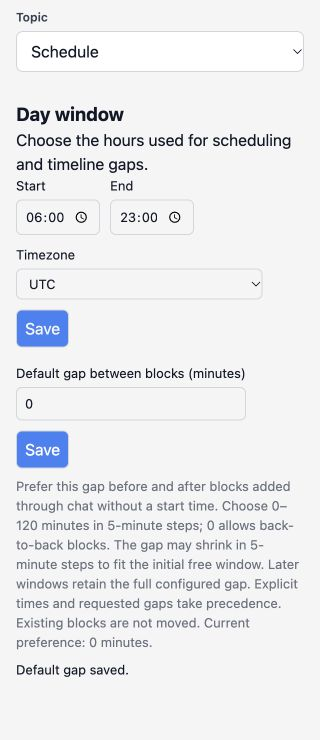
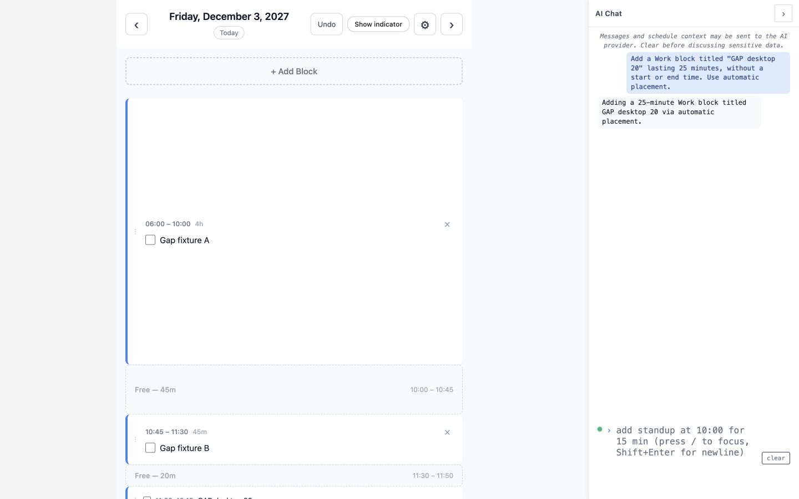

# Production-проверка промежутка между блоками из PR #265

23 октября 2026 года. Проверен [production](https://dayforge.habitreward.org) на релизе `a2e6133868294d02f6797bab480f6cd4bb72469a`, опубликованном после PR #269. Он включает [PR #265](https://github.com/erzhan12/day-forge/pull/265). [Deploy #39975827721](https://github.com/erzhan12/day-forge/actions/runs/39975827721) завершился успешно. Точная версия подтверждена в метаданных страниц браузера; [метаданные Deploy](evidence/block-gap-2026-10-23/deploy.json) сохранены отдельно.

## Результат

Настройка 0/10/20 минут прошла проверку на desktop и mobile. Каждое значение сохранено через Settings → Schedule, пережило Logout и свежий вход, затем использовалось при реальном AI-добавлении. Все шесть автоматических добавлений и два явных размещения отменены кнопкой Undo. Ошибок настройки gap в этом прогоне не обнаружено, runtime-код не менялся.

Проверены размеры viewport 1440×900, 390×844 и 320×740. В штатных состояниях и при ошибках валидации `scrollWidth` не превышал `clientWidth`. При наличии обычной вертикальной полосы прокрутки доступная ширина документа была на 15 px меньше viewport. Это не горизонтальное переполнение.

## Аккаунт и контрольные данные

Использован существующий выделенный non-staff production-аккаунт. Его исходная настройка gap равнялась 10 минутам, рабочее окно составляло 06:00–23:00 UTC. Тема, подсказки чата, категории, интеграции и рабочее окно не менялись. Перед записью независимый HTTPS-клиент проверил, что шесть будущих дат, 1–6 декабря 2027 года, не содержат блоков.

В каждый день через обычный API с `expected_revision` добавлены только синтетические Work-блоки:

| Блок | Время |
| --- | --- |
| Gap fixture A | 06:00–10:00 |
| Gap fixture B | 10:45–11:30 |
| Gap fixture C | 12:35–23:00 |

Получились свободные окна длительностью 45 и 65 минут. Первый блок начинается на границе рабочего дня, поэтому начальное окно пусто. По контракту поиск в последующих окнах сохраняет полный настроенный gap: уменьшение отступа для начального окна здесь неприменимо. Это позволяет проверить отступ с обеих сторон независимо от времени запуска теста.

Сохранение настройки проверялось при существующих блоках. На трёх ещё не использованных для AI днях независимые чтения подтвердили полное совпадение блоков, их IDs, revision и status после смены 0→10→20. [Состояния контрольных дней](evidence/block-gap-2026-10-23/preference-preserves-fixtures.json).

## Сохранение и реальные AI-запросы

Для каждой строки выполнена отдельная последовательность: сохранить значение в UI, дождаться `Default gap saved.`, выйти, войти паролем, заново открыть Settings, проверить поле и справку, открыть контрольный день и отправить запрос в чат.

Текст запроса:

```text
Add a Work block titled "GAP desktop 0" lasting 25 minutes,
without a start or end time. Use automatic placement.
```

В остальных случаях менялись только название, ширина и значение gap. Модель должна была передать длительность без конкретного времени. Scoped production-аудит подтвердил отсутствие `start_time` и `end_time` во всех шести сырых ответах. Время выбрал сервер, а не модель.

| Viewport | Gap | Дата / Schedule ID | Фактическое время | Отступы до соседей | Повторный вход / Undo |
| --- | --- | --- | --- | --- | --- |
| 1440×900 | 0 | 2027-12-01 / 137 | 10:00–10:25 | 0 / 20 минут | прошли |
| 1440×900 | 10 | 2027-12-02 / 138 | 10:10–10:35 | 10 / 10 минут | прошли |
| 1440×900 | 20 | 2027-12-03 / 139 | 11:50–12:15 | 20 / 20 минут | прошли |
| 390×844 | 0 | 2027-12-04 / 140 | 10:00–10:25 | 0 / 20 минут | прошли |
| 390×844 | 10 | 2027-12-05 / 141 | 10:10–10:35 | 10 / 10 минут | прошли |
| 390×844 | 20 | 2027-12-06 / 142 | 11:50–12:15 | 20 / 20 минут | прошли |

При gap 20 окно 10:00–10:45 пропущено: для блока в 25 минут и двух отступов нужно 65 минут. В следующем окне блок занял 11:50–12:15. При gap 0 допустимо касание границы соседнего блока в 10:00.

Запись и Undo проверялись отдельной авторизованной HTTPS-сессией, не через состояние Vue. Во всех шести днях создание изменило revision 3→4, Undo изменил её 4→5 и восстановил содержимое трёх контрольных блоков. Действующий restore API пересоздаёт строки с новыми IDs; от Undo проверялось совпадение названий, категорий, времени, порядка и completion, а не сохранение первичных ключей. До Undo AI-добавление сохраняло исходные IDs и поля соседей. Undo не откатывал настройку gap.

## Приоритет явного размещения

При сохранённом gap 20 выполнены ещё два реальных AI-запроса:

- Desktop: `Add a Work block titled "GAP desktop explicit" from 10:00 to 10:25 exactly. Keep its requested times unchanged.` Блок сохранился ровно в 10:00–10:25 без вопроса или сдвига.
- Mobile: `Add a Work block titled "GAP mobile explicit" immediately after "Gap fixture A", with a 0-minute gap, lasting 25 minutes.` Блок сохранился в 10:00–10:25 с явно запрошенным нулевым отступом.

Оба запроса использовали восстановленные контрольные дни после предыдущего Undo. AI передал конкретное время, которое сервер применил без восстановления стандартного gap. Оба результата отменены кнопкой Undo, содержимое соседей совпало с исходным; revision в этих двух днях прошла 5→6→7.

Всего получено восемь успешных production-записей AIInteraction, IDs 951–958. Заглушки, перехват запросов и изменение ответов провайдера не использовались. Аудит читался только с фильтром по шести контрольным Schedule ID. [Полные записи](evidence/block-gap-2026-10-23/ai-audit.json) и [разобранные действия](evidence/block-gap-2026-10-23/ai-summary.json).

## Валидация и мобильный интерфейс

На ширине 320 px проверены пустое поле, 7 и 121 минута. На desktop проверено дробное значение 7.5. Во всех случаях UI показал `Choose an integer from 0 to 120 minutes in 5-minute increments.` Справка продолжала показывать принятое значение 20; после дробного ввода независимый GET preferences также вернул 20. Пустое поле не превратилось в ноль.

Валидный 0 сохранён на ширине 320 px. Поле, Save, описание и статус сохранения помещались по ширине; длинное описание и ошибка переносились. Следующий вход на 390 px сохранил ноль. Справка Templates & Rules при gap 20 показывала `20-minute gap before and after the new block` и объясняла сохранение полного gap в последующих окнах. [Текст справки](evidence/block-gap-2026-10-23/rules-help-20.json).

Основные измерения, тексты и состояния страниц находятся в [browser observations](evidence/block-gap-2026-10-23/browser-observations.json). Серверные снимки до и после каждого Undo находятся в [server observations](evidence/block-gap-2026-10-23/server-observations.json). Credentials, cookies и подписанные restore proofs в evidence не включены.





## Автоматические проверки

На том же исходном коде выполнены:

| Проверка | Результат |
| --- | --- |
| `make check` | Ruff и TypeScript прошли; backend: 2359 passed, 1 skipped; frontend: 1459 passed в 105 файлах |
| `make frontend-build` | production-сборка прошла |
| `makemigrations --check --dry-run` | изменений моделей нет |
| Django system check | замечаний нет |
| Production npm audit | 0 vulnerabilities |
| Deployment image retention tests | PASS |
| Локальный эквивалент CI-проверки SSH pinning | все 7 ssh/scp команд сохраняют обязательную проверку host key |

Единственный skip относится к существующему opt-in R11 live comparison. Штатные backend/frontend тесты используют управляемые ответы AI. Восемь платных production-вызовов выполнены отдельно через браузер. [Результаты команд и hashes логов](evidence/block-gap-2026-10-23/checks.json).

Автоматический набор также проверяет границы 0–120 с шагом 5, fallback 10, изоляцию пользователей, атомарный отказ API, миграцию существующих preferences, начальные уменьшенные отступы, отсутствие слота, смену gap во время AI, устаревший pending intent и replay завершённого request_id после изменения настройки. Эти управляемые случаи не выдаются за дополнительные production-сценарии.

## Очистка и границы проверки

Исходный gap 10 восстановлен через Settings и подтверждён после reload и независимым API GET. Тема и подсказки чата совпали с исходными. Контрольные блоки удалены через revision-guarded restore после проверки их содержимого. Независимые серверные чтения подтвердили, что все шесть дат пусты. Новые пустые Schedule, revisions, durable receipts и записи AI-аудита остаются в базе; очистка блоков не является откатом базы. [Итог очистки](evidence/block-gap-2026-10-23/cleanup.json).

Во время очистки один GET контрольного дня 2027-12-05 в отдельном HTTPS-клиенте завершился read timeout через 150 секунд до отправки мутации. Новый GET прошёл, очистка продолжилась с актуальной revision. Браузерные обращения в это время работали. Причина единичного timeout не установлена; данных для вывода о дефекте gap нет. Повторный полный проход подтвердил пустые дни.

На ширине 320 px Logout проверен физическим кликом после прокрутки: центр кнопки не перекрыт чатом. После выхода браузер показал Login, Back сохранил Login без приватного расписания, reload защищённого URL вернул Login. Отдельная HTTP-сессия также завершена. Созданные для проверки вкладки закрыты, временный viewport сброшен. [Проверка доступности кнопки](evidence/block-gap-2026-10-23/mobile-320-logout-hit.json) и [снимок](evidence/block-gap-2026-10-23/mobile-320-logout-control.jpg).

Это проверка responsive-интерфейса в Chromium. Она не закрывает отдельную задачу настоящего iPhone/Safari. В этом прогоне не выполнялись нагрузочные гонки, контейнерный upgrade/rollback, обращения к чужим аккаунтам или внешним OAuth-интеграциям.
