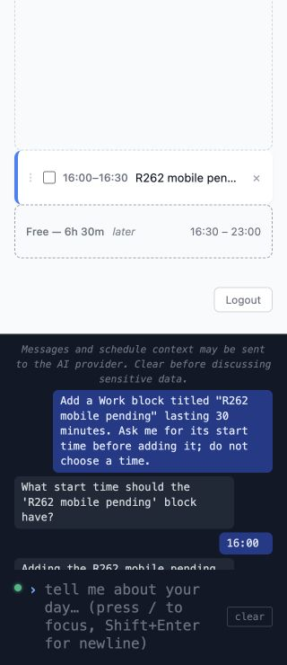

# Production и rollback после PR #262

23 октября 2026 года, Asia/Almaty. Проверен опубликованный релиз `ac8b4a04c9ba9bb485478fe504343477eb40b8e2` на [dayforge.habitreward.org](https://dayforge.habitreward.org). Найденные исправления находятся в ветке `codex/post-pr262-release-verification`; в production они ещё не опубликованы.

## Результат

[Deploy #39883221951](https://github.com/erzhan12/day-forge/actions/runs/39883221951) завершился успешно: validation, build/push, deploy и HTTPS health-check. Публичная Login, авторизованный desktop и mobile загрузили `ac8b4a0`. JS и CSS вернули 200 с immutable cache policy. Версия и SHA-256 файлов сохранены в [public-release.json](evidence/post-pr262-2026-10-23/public-release.json).

Production прошёл свежий вход, перенос существующего блока через реальный AI и pending intent, Undo и Logout на desktop/mobile. Независимый HTTPS-клиент подтвердил точный replay `request_id`, конфликт изменённого тела и replay после Undo без повторной записи. Проверка добавления через уточнение и частичного запроса выявила ошибки, описанные ниже. Поэтому весь production smoke не считается зелёным.

Контейнерный кандидат прошёл обновление, рестарт, два rollback/reupgrade, сохранение receipts и открытых scopes, ручную запись при rollback, отказ устаревшему intent и продолжение без повтора принятого блока. Отдельные проверки закрыли найденные ошибки и сохранение настоящего относительного ограничения. Исходная локальная база не изменена. Все контейнеры и сети репетиции удалены.

## Production: границы и сценарии

Использован существующий неадминистративный тестовый аккаунт, user ID 2. Credentials прочитаны из прежнего приватного файла вне репозитория. Пароль и настройки пользователя не менялись. Блоки создавались только на предварительно проверенных пустых датах 23, 24 и 25 октября 2027 года. Production-база не скачивалась; SSH не использовался.

| Проверка | Наблюдение |
| --- | --- |
| Desktop 1440×900 | Свежий password login; SHA совпал с Deploy, scrollWidth 1440 |
| Desktop AI | Ручной baseline 09:00–09:30; реальный вопрос о новом времени; ответ `14:00` перенёс только этот блок на 14:00–14:30 |
| Desktop Undo | Первая кнопочная отмена вернула 09:00–09:30, вторая убрала ручной baseline; независимый GET подтвердил пустой день и revision 4 |
| Desktop Cancel | Отмена открытого запроса убрала ссылку без изменения пустого дня и без Undo. Число audit-записей тестового дня осталось 2 |
| Desktop Logout | Login после выхода; Back показал Login вместо приватной страницы |
| Mobile 390×844 | Повторён свежий вход при измеренной ширине 390; baseline 09:00–09:30, реальный AI-вопрос и ответ `15:00`, перенос на 15:00–15:30 |
| Mobile Undo и Cancel | Undo вернул baseline, что подтвердил независимый GET. Новый вопрос отменён при 320×740; baseline сохранился, следующая Undo убрала исходное ручное создание |
| Mobile Logout | При 320 px выход с открытым чатом показал Login; Back и защищённый reload не вернули расписание. scrollWidth равен 320 |
| HTTP ask/reply replay | То же тело и UUID вернули побайтно тот же ответ. Свежие GET не обнаружили повторного блока или изменения revision |
| HTTP после Undo | Повтор завершённого UUID вернул старый receipt, но день остался пустым |
| HTTP отрицательные случаи | Изменённое тело: `409 request_id_conflict`; новая попытка со ссылкой на завершённое намерение: `409 pending_intent_stale`; Cancel и его точный replay не изменили расписание |

Действия с интерфейсом выполнены через CUA. HTTP replay проверялся отдельным HTTPS-клиентом, а не через подмену браузерного транспорта. Искусственная потеря соединения и конкурентная нагрузка в production не запускались. TLS проверялся с доверенным CA bundle. Ответы AI не подменялись.

Первое переключение mobile viewport затронуло другую тестовую вкладку: DOM показал 1440×900. Этот замер сохранён, но не засчитан как mobile. После закрытия второй вкладки ширина 390 проверена повторно; свежий вход и сценарий выполнены заново. Login после Back может отображаться по прежнему защищённому URL; проверялось содержимое страницы и результат reload.

Logout активировался через accessibility API. При 320 px footer находится ниже первого экрана длинного расписания; этот прогон не доказывает, что его координата доступна без вертикальной прокрутки. Горизонтального переполнения нет.

Итоговый независимый GET подтвердил пустые три тестовые даты. Schedule rows, revision, audit, receipts и intents сохраняются согласно контракту; возврат пустых блоков не является побайтным откатом базы. Исходная Chrome admin-сессия и пользовательские вкладки сохранены. Для диагностики открывалась отдельная временная вкладка с audit только этих тестовых Schedule.

## Найденные ошибки и исправления

### Вычисленная граница времени считалась расширением scope

Реальная модель вернула известную длительность 30 минут и единственный `missing_fields: ["start_time"]`. После ответа `14:00` она предложила корректный интервал 14:00–14:30. Сервер отклонил вычисленный `end_time` с `409 pending_intent_scope`. Записи и Undo не появилось. Исходные ответы сохранены в [audit evidence](evidence/post-pr262-2026-10-23/derived-time-production-audit.json).

Сопоставление теперь допускает только однозначно вычисляемую границу: разрешённое время и длительность определяют второе время. Сохранённые значения остаются неизменными. Отрицательные тесты запрещают противоречащую длительность, изменение известного start/end и выбор произвольного интервала при разрешении уточнить только duration. Добавлены успешные случаи для start, end и duration, включая replay без второй записи.

### Структурированный остаток терялся при `ask: null`

В production модель добавила `R262 accepted`, вернула `pending_actions` для второго блока, но оставила `ask: null`. Сервер сохранил первый блок и ответил `pending_intent: null`, `partial: false`. Остаток нельзя было продолжить. Это подтверждённые структурированные данные, а не вывод из свободного explanation. См. [исходный ответ](evidence/post-pr262-2026-10-23/partial-provider-omission.json).

Теперь валидный остаток сохраняется после выполнения готовых действий. Сервер задаёт нейтральный вопрос и возвращает `partial: true`, если в этом turn была запись. Принятые IDs берутся из persistence. Для continuation дополнительное предложение проходит проверку оставшихся разрешений и не может повторить принятую часть. Старый контракт «явный вопрос модели подавляет запись всего turn» сохранён. Prompt объясняет, как вернуть готовые actions и структурированный остаток с `ask: null`.

HTTP-тест проходит через настоящий service/parser с подменой только SDK: готовый блок записывается один раз, пропущенный вопрос восстанавливается, UUID replay не вызывает SDK, а ответ на остаток добавляет только второй блок.

### Relative guard зацикливал вопрос и расходовал неприменённое разрешение

Фраза `Ask me for its start time before adding it` принималась за относительное добавление. Даже после корректного `14:00` guard спрашивал, перед каким существующим блоком поставить новый. Модель при этом возвращала правильный абсолютный интервал. Вопрос guard без записи затем превращал исходный scope в пустой.

Явный ответ HH:MM теперь разрешает непривязанный ориентир, когда модель вернула конкретный интервал. Это не отключает проверку существующего anchor: тесты и контейнерный сценарий продолжают отклонять время до Gym при исходном `after Gym`. Ответ длительностью и untimed add также не обходят guard. При отказе guard разрешение сохраняется для исправленного ответа; несуществующие block IDs и расширение scope по-прежнему отвергаются.

## Исправленный кандидат: браузер с реальным AI

Проверен тот же frontend и исправленный backend на изолированной локальной базе. OpenRouter был доступен; выполнены шесть реальных вызовов `x-ai/grok-4.3`, без заглушек. Это модель локальной конфигурации; ID модели production этим прогоном не подтверждается.

| Проверка | Результат |
| --- | --- |
| Desktop 1440×900, исходная формулировка `before adding it` | После вопроса о начале ответ `14:00` создал ровно один блок 14:00–14:30. Intent закрыт, Undo вернул baseline |
| Desktop, готовая часть и пропущенный вопрос | `R262 accepted` применился на 13:00–13:30. Сервер сохранил остаток и задал вопрос. Ответ `15:00 to 15:30` создал только `R262 unresolved`; принятый блок не повторился |
| Desktop Undo частичного плана | Первая отмена убрала только unresolved, вторая только accepted |
| Mobile 320×740 | Та же формулировка и ответ `16:00` создали 16:00–16:30; Undo вернул Gym и Focus. scrollWidth остался 320 |
| Mobile Logout | После обычной прокрутки Logout находилась выше открытого чата. DOM hit-test центра вернул саму кнопку; нажатие координатой показало Login. Back и reload не вернули приватную страницу |

Независимое чтение SQLite подтвердило шесть успешных AI interactions, шесть terminal 200 receipts, три resolved intent, исходные Gym/Focus на обеих датах и отсутствие сессий после Logout. См. [local-real-ai.json](evidence/post-pr262-2026-10-23/local-real-ai.json) и [измерения браузера](evidence/post-pr262-2026-10-23/browser-observations.json). Снимки сохранены в [каталоге проверки](screenshots/post-pr262-2026-10-23/).

## Репетиция на копии базы

Воспроизводимый раннер: [`rehearse_pending_intents.py`](../deployment/scripts/rehearse_pending_intents.py). Он использует общий Compose harness и отдельный fixture provider. Реальные ASGI, entrypoint, миграции, Redis и лимит web-памяти 250 MiB сохранены. Сеть web/Redis/provider внутренняя; наружу опубликован только proxy на `127.0.0.1:8011`. В контейнерных сценариях нет production-соединений или платных AI-вызовов.

Источник: read-only SQLite backup локальной рабочей базы, 26 таблиц и 1204 строки. Публикуются только hashes/counts. Если в копии уже есть пустая `ai_pendingintent`, раннер возвращает только копию к `ai.0007`; непустая таблица приводит к отказу. Обычный image rollback обратную миграцию не выполняет. Существующие строки проверены по hashes; оригинальный источник проверен повторно после выполнения.

Старый образ собран из `3b2820e`, опубликованный из `ac8b4a0`, кандидат из исправленного кода с release marker `pr262-pending-final-candidate`. Использован production Dockerfile; это локальные source builds для arm64, а не скачанные production-образы. Их побайтная идентичность GHCR не утверждается. SHA-256 frontend assets source build совпали с production. IDs образов и hashes исправленных runtime-файлов сохранены в [image-source.json](evidence/post-pr262-2026-10-23/image-source.json).

| Этап | Результат |
| --- | --- |
| `ai.0007 → ai.0008` | Существующие строки сохранены, integrity check успешен |
| Рестарт с открытым intent | UUID/version, scope, expiry и receipt сохранились; точный replay не вызвал provider |
| Первый rollback/reupgrade | AI приостановлен. Открытый intent сохранился; после возвращения нового образа ответ применился и replay не повторил запись |
| Второй rollback | Частично принятый блок и его ID сохранились; старая версия позволила ручную запись |
| Возврат после ручной записи | Старый receipt остался побайтно прежним, а continuation получил `pending_intent_stale` без нового provider call |
| Новый ответ на остаток | Принятый sibling не повторился; новая ручная запись сохранилась |
| Cancel | Не вызвал provider, закрыл намерение, повтор UUID вернул тот же результат |
| Исправления | Start-only интервал применился, пропущенный вопрос восстановлен, процедурное `before` разрешилось; настоящий anchor отклонил неверное время и принял исправленное |

Старая версия уже поддерживает durable UUID. Поэтому её новый запрос при отключённом AI создаёт terminal 503 receipt. Раннер проверяет сохранность всех прежних receipts и ровно одну новую запись 503, а не неизменность всей таблицы после нового запроса.

Проверки живых scopes/receipts читают SQLite внутри web-контейнера. Для startup оставлено production grace period 40 секунд; частые probes не должны объявлять приложение unhealthy во время миграций и collectstatic под нагрузкой. Неуспешные подготовительные запуски не отмечались как успешные, Compose cleanup выполнялся и после ошибок.

Результат опубликованного образа сохранён как [negative control](evidence/post-pr262-2026-10-23/container-released-known-failure.json): основные update/rollback-переходы прошли, start-only probe получил ожидаемый дефект 409, `success: false`. Исправленный кандидат: [success и cleanup true](evidence/post-pr262-2026-10-23/container-fixed.json). Команда запуска и ограничения источника описаны в [runbook](../deployment/README.md#container-rehearsal-on-a-database-copy).

## Проверки и оставшиеся границы

`make check`: **2245 backend passed, 1 skipped; 1422 frontend passed в 104 файлах**. Ruff, TypeScript и production frontend build прошли. Отдельно прошли Ruff для deployment scripts, Django system check, migration drift check и image retention tests. Production dependency audit: 0 vulnerabilities. Единственный skip относится к платному opt-in R11 comparison; реальные provider calls выполнены через production и локальный browser smoke. Результаты: [checks.json](evidence/post-pr262-2026-10-23/checks.json).

Production остаётся на `ac8b4a0` с найденными дефектами. После merge и Deploy исправлений нужно повторить точные start-only и partial-without-question сценарии на тестовом аккаунте. Реальный iOS Safari, живые OAuth-интеграции, нагрузочные границы и оценка качества модели на корпусе этим smoke не закрываются.
